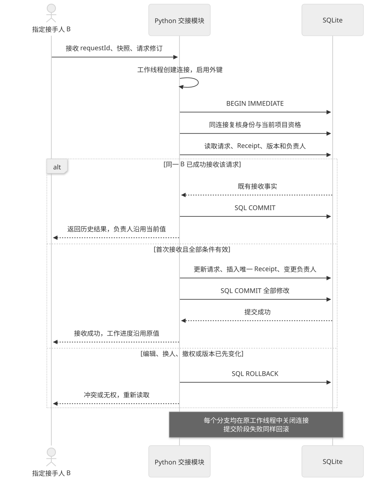

# 团队 AI 工作交接助手软件设计说明书

SDD 0.5 技术栈定稿 · 第 16 组 · 2026-11-13

## 1 设计依据与状态

需求基线采用本项目 SRS 1.6 的功能需求、D-01–D-05、业务规则和 AT-01–AT-10，供 Assignment 2 设计评审使用。团队已确定前端采用 React + TypeScript + Vite，后端采用 Python + FastAPI，SQLite 通过 Python 原生 `sqlite3` 访问，Uvicorn 提供 Web 服务，HTTPX 调用外部模型 API。系统采用模块化单体，在本地局域网部署，MVP 面向 2–4 人。具体模型供应商、Python 及依赖版本和部署运行参数仍待确定，产品实现、性能、成本与用户效果等待后续验证。验收门槛沿用 SRS。[SRS 原文](../团队AI工作交接助手需求与设计说明书/团队AI工作交接助手需求与设计说明书_完整中文版.md)

本版结合本地 PoC 与 handoff-verify 的两组任务记录修订来源、审核和失败恢复设计。已运行的原型覆盖记录保存、结构化交接及新 Agent 接手，单次对照为信息完整性与成本取舍提供初步依据。Web 多人交接、SQLite 事务和质量门槛仍待产品实现验证。证据取自本地现有报告及仓库提交 `99403a53dada1224709c8853c9944b6778298ac1`，定位见 §7.1。该仓库的 SRS 副本与本项目对补充请求的状态描述有差异，业务规则沿用上述本地基线。

首版面向 2–4 人，覆盖 FR-001–FR-021。设计围绕三件事展开——A 能以合理负担整理并核对来源，B 能识别确定版本及未知事项，服务端能可靠记录双方同意的责任转移。提醒、自动版本差异和专有格式适配继续按 FR-022–FR-024 延后。

### 1.1 产品阶段与交付范围

- **第一阶段 MVP，人工采集与 AI 辅助交接。** 用户创建任务并主动导入开发记录、任务信息及相关材料，AI 生成带来源的结构化草稿。A 核对、修改并确认，B 阅读、补充沟通后主动接收，形成当前 SRS 的业务闭环。自动开发事件采集、Coding Agent 和 Harness 执行器均在此阶段范围之外。
- **第二阶段规划，自动采集与持续上下文管理。** 接入外部 Harness、Coding Agent 或其他开发工具的事件记录，持续整理进展、决策变化、工具与测试结果及未完成事项，保留来源和历史。交接时基于已维护上下文生成材料，沿用第一阶段的人工审核、确认和责任交接。该方向已由团队确定，具体需求、接口和验收仍待演进评审，属于未来产品规划。

§3–6 描述第一阶段设计，§3.3 单列未来扩展边界，§8.3 列出进入第二阶段前需要协调的需求。现有原型证据的适用范围见 §7.1。

## 2 关键设计决策

### AD-01 用模块化单体集中维护业务规则

采用一个 Python 业务进程、一个本机 SQLite 数据库，按权限、任务材料、草稿审核、交接四个职责分区，以 Python 包和函数组织。人工确认和责任转移涉及同一组数据，集中事务可减少跨组件失败状态，符合小团队和本地演示条件。微服务会增加部署与跨服务一致性成本，当前需求缺少对应收益。后续扩展先调整模块边界与容量，再重新评估拆分。依据为 SRS §2.3–2.4、NFR-006、011。

### AD-02 采用 React、FastAPI 与原生 sqlite3 支撑交接界面和业务接口

React 以组件组织任务、来源核对和交接界面，TypeScript 帮助检查接口字段与状态类型，Vite 统一构建静态产物，支持 UI-01–06 的界面开发。Python 后端使用 FastAPI 组织 JSON 路由，通过其 Pydantic 模型校验请求和模型响应，业务层执行授权与状态规则。SQLite 与原生 `sqlite3` 适合首版小规模关系数据，参数化 SQL 和显式事务便于核对接收与责任转移，团队需自行维护 SQL 与约束。技术选择已由团队确认，具体版本在实现前锁定。依据为 SRS §2.4、NFR-006、011。[FastAPI 同步与异步说明](https://fastapi.tiangolo.com/async/)、[Python sqlite3 文档](https://docs.python.org/3.13/library/sqlite3.html)

### AD-03 多人访问同一台本地主机

成员各自登录浏览器，共用局域网主机上的服务与数据，保障 A、B 操作同一份请求。Web 服务采用 Uvicorn 承载 FastAPI，当前部署设计以单 worker 直接提供 HTTPS，应用同源提供静态资源。该组合支持 Windows 本地主机，部署进程与运维步骤较少。代价是主机可达性、开机维护和客户端证书信任配置。团队若已有可信 HTTPS 代理，可复用该入口。主机与网络条件、worker 数量及 TLS 配置待目标环境验证，见 §8。依据为 FR-001–002、NFR-002、003、008。

### AD-04 固定确认快照与来源版本

材料修订追加新版本，人工确认时固定五项正文、任务背景、引用集合及来源定位。B 的接收记录始终指向这一快照。重要变更在保存事务中撤销当前可交接性，历史内容仍可回看。相比覆盖正文后依赖日志重建，直接保存快照更容易解释接收依据。代价是保留多个小文本版本，符合课程演示的材料规模。依据为 FR-007、012、014、018、020，NFR-007。

### AD-05 用短事务、修订校验和唯一约束保护交接

确认、发起、补充、拒绝、接收及影响它们的编辑采用统一事务边界。数据库约束保障单有效请求与单次接收，服务端在事务内复核当前权限和版本。客户端按钮状态帮助操作，最终有效性由服务端判定。该机制解决重复提交、旧页面与并发编辑的实际风险，复杂度集中在核心业务。依据为 D-01–D-03、FR-017–018、NFR-006。

### AD-06 AI 作为可替换的草稿来源

生成适配器接收已获用户确认的输入，返回另存候选。结构和引用定位可程序检查，事实含义由 A 对照证据核对。人工填写沿用相同编辑与确认入口，模型失败时业务闭环仍可继续。自动判真或 Agent 执行器会引入权限和验证成本，现阶段采用明确来源、可见未知和人工负责的方式。依据为 FR-008–012、021、D-05、NFR-003、004、009。

原型已跑通结构化材料生成与新会话接手，同时暴露隐含决策漏提取、低价值日志混入和引用支持不足的问题。生成适配器负责产生结构化候选，界面按五项内容固定展示，审核重点放在缺失约束、证据与未知事项。该依据支持当前人工审核边界，原型验证范围见 §7.1。

### AD-07 先验证人工交接闭环，再扩展自动采集

第一阶段通过人工导入控制接入成本和材料范围，先验证来源核对、确认版本及责任转移是否支持有效交接。第二阶段再针对重复录入负担增加来源适配与持续整理。实验已显示事件记录和上下文更新具有局部可行性，同时存在记录缺失、提取遗漏和成本波动，因此后续自动化围绕同一交接闭环逐步接入。阶段划分见 §1.1，待演进需求见 §8.3。[验证发现][verify-report]、[补充任务限制][verify-csv-report]

## 3 Logical Architecture

[编辑图源](图源/logical.mmd)

### 3.1 模块职责与依赖

| 模块 | 负责的业务及依赖 |
| --- | --- |
| 身份与项目权限 | 登录会话、项目与成员资格、初始分配权限。各业务入口调用授权检查，写操作在事务内复核。 |
| 任务与材料 | 目标、验收标准、工作进度、材料版本和来源定位。向审核提供确定版本，重要编辑同步使相关确认需重审。 |
| 草稿与审核 | 人工编辑、输入预览、生成候选、条目引用校验、人工确认快照。生成适配器由本模块调用。 |
| 交接 | 指定成员、请求补充、拒绝、主动接收和历史回看。读取快照、当前权限及负责人，统一执行责任变更。 |

FastAPI 路由分派命令，Python 业务包通过进程内函数协作。每个数据库工作单元内部传递同一 `sqlite3.Connection`，任务与权限查询、条件更新和历史记录共同使用该连接。事务在最外层工作单元统一结束。生成适配器只连接外部文本模型，业务模块掌握全部业务写入能力。线程执行边界见 §5.2。

### 3.2 主数据流

1. A 创建任务，导入 UTF-8 文本或关联链接，服务端保存材料编号和版本。
2. A 选择允许外传的正文，预览后确认发送，模型返回五项候选。A 也可直接人工填写。
3. A 逐项核对正文与来源，修正证据缺口后确认，服务端形成固定快照。
4. A 指定 B 发起请求，B 阅读该快照与来源，决定补充、拒绝或主动接收。
5. 有效接收同时提交接收记录、请求结果与负责人变更，后续工作沿用新负责人的权限。

模型输入确认、交接内容确认、责任接收分别对应三个独立人工动作。工作进度由负责人单独维护。

### 3.3 第二阶段架构演进方向

以下为未来设计建议。外部开发工具产生记录，来源适配器将获准记录归一化后交给任务与材料模块保存，再由草稿与审核模块持续维护上下文候选。需要交接时，选定一个确定的上下文版本及来源集合，复用生成适配器、人工审核、固定确认快照和交接模块。

来源适配器拟作为现有 Python 单体内的包接入，每种来源负责其格式转换。外部 Harness 或 Coding Agent 提供事件，仍在产品运行边界之外。持续整理归入草稿与审核职责，材料编号、版本、来源回看和持久化复用现有机制。现有架构图展示 MVP，未来扩展仅在本节约定职责和数据衔接，具体部署方式待第二阶段需求确定。

| 接口 | 第二阶段最小数据与处理约定 |
| --- | --- |
| 记录提交 | 获权成员明确绑定项目、任务与来源会话。记录包含来源标识、稳定事件编号、来源会话内顺序、时间、声明者、事件类型、执行状态、正文及定位。同次工具调用的开始和结果可关联，测试记录附已有的对象版本、方法及结果条件。 |
| 接收回执 | 保存成功后返回材料编号、版本和可恢复位置。按来源、来源会话及稳定事件编号识别重传，内容和归属一致时返回既有材料，冲突时明确报告。恢复位置按已确认保存范围推进，缺口保留并标为未知。 |
| 候选更新 | 条目带内容、当前候选状态和来源材料版本及片段，历史保留取代、撤销或重开依据。写回核对输入截止位置或上下文修订、当前权限及人工草稿修订，过期结果沿用 §6.2 的独立候选与失效隔离。 |

来源内顺序用于续接和更新判断，跨工具记录分别保留其顺序及时间。明确来源支持取代、撤销或重开时更新当前候选，语义不确定或记录矛盾时保留待核对项。原始记录追加保存，派生上下文始终可回看依据。执行中缺少结束结果、重启后缺失事件和未记录的外部变更均显示未知，完整性与恢复能力需在目标系统验证。[事件与更新发现][verify-report]、[中断恢复边界][verify-recovery]

持续上下文中的进展和完成声明用于辅助整理，任务工作进度由负责人维护。采集和候选更新后，正式确认与接收仍由人触发。用户采纳内容时复用修订校验，未引用的新材料按 D-03 保留既有确认的有效性，正文、背景或既有引用变更时依 §6.3 重审。历史确认快照与接收事实保留原依据。

自动采集先形成本地可追溯材料。持续整理可先以本地规则更新候选，涉及外部模型时沿用 FR-008、D-05 的逐次输入预览与确认，预览覆盖实际发送的上下文文字与来源片段，条目保留到原材料版本的定位。若未来采用后台持续模型提取，其授权范围、撤销和预算需先按 §8.3 完成需求评审。上述接口为演进约定，具体字段格式和实现留待第二阶段确定。

## 4 Deployment Architecture

[编辑图源](图源/deployment.mmd)

### 4.1 运行与访问

推荐由一名成员维护共用主机，其他成员通过稳定的局域网地址访问同一 HTTPS 入口。Python 虚拟环境安装锁定版本的运行依赖，Uvicorn 当前按单 worker、标准 asyncio 事件循环设计，具体运行参数待验证。FastAPI 提供 `/api/` 与 Vite 构建产物，SQLite 文件、TLS 私钥和模型密钥位于静态资源目录之外的受限目录。演示运行使用固定配置并关闭开发热重载。

TLS 证书须覆盖实际访问的域名或 IP，各设备通过可信方式建立证书信任。主机防火墙限定团队所在网络和业务端口。推荐通过 Uvicorn 的 `--ssl-certfile`、`--ssl-keyfile` 指定证书与私钥，由该服务终止 HTTPS。证书准备、局域网互访与主机 Python 环境是演示前需检查的条件。[Uvicorn HTTPS 与运行设置](https://uvicorn.dev/settings/)

Python 应用通过 HTTPX AsyncClient 发起出站 HTTPS，请求经过用户范围确认并验证服务端证书。MVP 将外部仓库、私人开发环境与关联链接作为来源位置保留，正文获取走成员主动导入流程。模型网络不可用时，人工整理、审核和接收在局域网内继续使用。

### 4.2 身份、维护与恢复

推荐预置每名演示成员的独立本地账号，服务端校验口令散列后建立随机、不透明的会话。口令散列实现、会话有效期和初始账号交付方式在实现前确认。会话 Cookie 采用 HttpOnly、Secure、SameSite，写请求同时校验同源来源与会话绑定的防伪令牌。服务端从会话取得操作者，逐次核对项目资格。

FastAPI 路由使用统一的服务端会话识别入口，Cookie 只携带不透明会话标识，实际会话和资格由数据库校验。Pydantic 对标识、枚举和五项正文采用明确类型与非空校验，状态命令拒绝未声明字段。应用统一转换校验失败、权限失败、修订冲突和数据库暂时不可用的 JSON 错误。SQL 使用参数绑定，材料与模型内容按文本展示，运行时错误响应清除内部堆栈和凭据。

项目负责人管理成员资格，任务创建时分配初始负责人，后续改派统一经主动接收。当前负责人移除操作在事务中检查其负责的任务，存在未交出的任务时提示先交接。撤销 B 资格与接收采用相同数据库事务纪律，按提交顺序判定权限。

主机停止会使成员暂时无法访问。推荐演示前停服后复制完整数据库，恢复时使用同一程序版本和对应数据版本，后续再验证恢复结果。恢复后以已提交记录为准，明确显示未完成调用及缺失结果。原型重启保留了部分工具事件，但被中断轮次的对话未落盘，说明恢复范围需要逐项核对。此发现支撑结果未知时查询与重试的设计，应用数据库的备份恢复另行验证。记录业务操作标识、操作者、时间、版本及生成用量，日志避开正文与凭据。演示数据及备份沿用 D-05 的评审结束后 30 日清理要求。[中断恢复记录][verify-recovery]

## 5 Technology Architecture

[编辑图源](图源/technology.mmd)

前端使用 React 与 TypeScript，Vite 将界面构建为 `dist` 静态产物。FastAPI 同源提供资源，API 路由优先注册，页面回退限定在前端页面路径，未知 `/api/` 路径返回接口错误。数据库、导入材料和密钥通过各自受控入口访问。Vite 的构建与预览属于开发工具用途。[Vite 静态部署说明](https://vite.dev/guide/static-deploy)、[FastAPI 静态资源](https://fastapi.tiangolo.com/tutorial/static-files/)

后端采用 Python + FastAPI，FastAPI/Pydantic 负责 HTTP 边界与结构校验，Uvicorn 负责 ASGI 服务和 TLS，标准库 `sqlite3` 负责持久化。HTTPX AsyncClient 负责外部模型 API 请求，以异步等待将模型网络耗时与数据库短事务分开，模型失败时沿用人工整理路径。Python 具体运行版本及依赖版本在实现前锁定，现有 §5.2 事务设计按 Python 3.13 接口描述，锁定版本时核对其兼容性。模型供应商待选，生成适配接口接收“固定输入、截止时间和调用标识”，返回“候选正文、引用、用量与失败原因”，模型差异集中在适配器及响应解析。

普通数据库端点使用同步 `def`，由 FastAPI 在线程池中执行完整工作单元。生成端点使用 `async def`，通过 `run_in_threadpool` 将完整同步数据库函数一次送入线程池，连接在该函数内部取得并释放。模型请求使用异步等待，事件循环可继续处理其他成员的请求。Python 单 worker 下仍有并发线程，业务一致性由数据库事务和约束维护。[FastAPI 调度规则](https://fastapi.tiangolo.com/async/)

初版采用每工作单元独立连接和 SQLite 默认回滚日志模式。写事务由 SQLite 排序，普通读取使用短读事务取得授权与对象的一致快照。吞吐量依 NFR-008 实测，日志模式和连接复用优化进入后续容量判断。[SQLite 隔离说明](https://www.sqlite.org/isolation.html)

### 5.1 三种架构的对应关系

逻辑视图中的四个业务模块及生成适配器全部位于 Uvicorn 单 worker 的 Python 应用进程内，由技术视图的 Python 包实现。线程池属于该进程的执行设施。统一持久化映射为主机上的 SQLite，浏览器界面映射为 React 构建产物，外部模型在三个视图中均处于业务系统边界之外。

### 5.2 Python 数据库工作单元

每个同步工作单元在当前线程中创建、使用并关闭连接，保持 `check_same_thread=True`，将查询结果转换为普通数据后返回。推荐显式指定 `sqlite3.connect(..., autocommit=True, timeout=0.5)`，并在事务前对每条新连接启用、检查 `PRAGMA foreign_keys=ON`。0.5 秒是建议锁等待上限，实际值待测。[Python 连接参数](https://docs.python.org/3.13/library/sqlite3.html#sqlite3.connect)、[SQLite 外键配置](https://www.sqlite.org/foreignkeys.html)

写工作单元依次执行以下步骤。

1. 在任何业务读取前执行 SQL `BEGIN IMMEDIATE`，取得写事务资格。
2. 用同一连接复核会话、当前权限、对象归属、请求状态与预期修订。
3. 执行参数化查询、条件更新及唯一记录插入，检查受影响行数。
4. 校验全部通过后执行 SQL `COMMIT`。校验或数据库异常时，若 `in_transaction` 为真则执行 SQL `ROLLBACK`，最后显式关闭连接。

这一事务模式统一使用 SQL 开始、提交和回滚。`autocommit=True` 下的 `Connection.commit()`、`rollback()` 和 `with connection` 无法承担上述显式事务的提交／回滚职责。读工作单元用 SQL `BEGIN` 将授权和受保护数据读取放在同一快照内，读取完成后结束事务并关闭连接。[Python 事务模式](https://docs.python.org/3.13/library/sqlite3.html#transaction-control)、[SQLite 事务语义](https://www.sqlite.org/lang_transaction.html)

开始或提交阶段遇到锁忙时返回明确的暂时不可用结果，提交失败仍检查事务并回滚。业务修订冲突直接引导刷新，事务内部保持数据库操作简短，模型调用、用户等待和响应渲染在事务外执行。客户端因断网无法判断接收结果时按请求标识查询既有事实。锁等待上限约束 SQLite 等锁行为，完整请求和模型生成另设各自的应用截止时间。

## 6 关键详细设计

### 6.1 核心数据与修订边界

以下定义逻辑记录和约束，供后续数据库设计使用。

| 记录 | 关键内容与约束 |
| --- | --- |
| Task | 项目、当前负责人、目标、验收标准、工作进度。保存任务背景修订号及负责人轮次，区分背景修改与责任变化。 |
| MaterialVersion | 材料编号、版本号、正文或链接、来源说明、导入者与时间。版本追加保存，引用定位到固定版本及行段。 |
| Draft / GenerationAttempt | 草稿五项内容、引用集合、草稿修订号和审核依据轮次。调用记录关联固定输入、发起者、当时负责人轮次、状态和用量，输出另存候选。 |
| ConfirmedHandoff | 固定任务背景、五项正文、引用关系、来源版本与定位、确认人和时间。当前有效性由关联修订及重审标记判断。 |
| Request / Response | 绑定任务、快照、发起人及当时负责人轮次、接手人、请求状态及修订。回应记录补充问题、A 回复、拒绝及失效原因。 |
| Receipt | 唯一请求标识、确认版本、接收者和时间。`requestId` 唯一，历史接收事实追加保存。 |

成员、项目关系与会话支撑身份校验。关联记录同时校验所属任务及项目，防止把其他项目的材料或快照拼入当前命令。

导入材料保留可识别的来源说明。原记录已有会话或事件编号时，可将其作为来源说明并按保存的材料版本定位行段。实验中的稳定来源定位可供借鉴，MVP 由 A 主动导入文本和关联链接。外部变更若缺少记录，A 补充材料或标记未知，服务端按实际导入内容建立引用。[原型来源检查](PoC验证报告.md)、[来源缺口抽查][verify-claims]

草稿修订号保护人工编辑，任务背景修订号保护目标和验收标准，负责人轮次保护接收后的权限。审核依据轮次随正文、背景、引用或补充回应变化递增，确认快照须绑定当前轮次才能用于新请求。材料引用以固定版本列表比较。未引用的新材料只增加材料记录，已有确认继续按原引用集合判断有效性。上述字段是建议实现方式，其作用集中在消除旧页面覆盖。

每任务的“待接收”和“需补充”请求共同受单有效请求约束，可用以任务为键、限定这两种状态的唯一索引实现。Receipt 对请求设置唯一约束。引用外键与项目归属校验共同约束数据关系。[SQLite 唯一索引与条件索引](https://www.sqlite.org/lang_createindex.html)

### 6.2 AI 输入、输出与人工审核

**输入确认。** 服务端按当前身份建立输入快照，内容包括任务目标、验收标准和所选正文片段，并保存材料版本及片段边界映射。预览显示实际发送的全部用户正文。确认发送携带快照标识，服务端重新检查权限、负责人轮次和相关修订，变化则要求重新预览。模型引用使用最小必要的材料标识与定位元数据，来源描述等额外正文须纳入预览选择范围。

没有可用的所选材料正文时，生成入口提示补充材料或人工填写。仅有任务目标、验收标准或未读取链接时停止模型调用。UTF-8 单文件上限沿用 1 MiB，单次模型输入正文合计上限沿用 20,000 字符，计入目标、验收标准与选定正文。超限提示用户选择片段，实际模型容量较小时提前提示更小范围。系统指令采用 SRS 附录丙的整理边界，材料按不可信文本输入，模型仅接收文本和返回结果。

**输出检查。** 五项分别为已完成事项、关键决策及理由、验证情况、遗留问题和下一步建议。五项均须有非空内容，空字符串与纯空白判为不合格，缺乏材料时显式写“未知／无材料”。建议每个条目包含内容、事实／建议／未知分类及引用，引用指向输入白名单内的材料版本和行段。服务端检查五项结构、字段形状、引用归属、版本及片段可定位性，范围校验覆盖实际发送的片段。无效引用隔离待修，合格输出另存候选。纯链接条目显示“未读取正文”，引用只能证明记录过该位置。

整理提示词要求优先保留影响接手的约束、决策理由和剩余事项，略去常规读文件、列目录等过程噪声。只在材料明确支持时更新事项状态，理由缺失时保留未知。原型的规则提取漏掉了隐含理由，模型提取又带入低价值完成项，因此两种方式的输出均需沿用候选审核。首版由一次生成返回五项结构，页面按固定结构展示。[本地提取限制](PoC验证报告.md)、[提取与噪声发现][verify-report]

**人工审核。** A 采纳候选时重新校验权限和预期草稿修订，再显式保存选择内容。五项正文旁显示引用片段，区分成员陈述与所附检查输出。优先处理“已完成”“验证通过”、矛盾和未知项，避免再次通读全部原始记录。来源类型由材料元数据和人工核对表达，程序检查的引用存在性与人工语义核实分别显示。缺少检查证据时改写为未验证，保留冲突及建议身份，再主动确认。人工新增说明同样标明来源或成员陈述。B 查看同一固定正文、确认者、时间、版本和来源，可据未知事项请求补充。

“验证情况”说明检查对象及版本、命令或方法、结果和已知条件，并引用相应材料。工具执行结束与任务达到验收标准分别核对，失败、中断或结果未知均如实保留。材料未注明适用版本或条件时标为未知，由 A 补充。材料显示检查后又修改代码时，A 将旧通过结论限定到当时版本，当前版本标为待重验。实验采用整体工作树指纹识别变化，注释修改也会使旧测试全部失效。首版由 A 对照导入证据核实适用版本，重审继续遵循 D-03 的正文、背景及引用变更范围。[验证证据与失效发现][verify-report]

A 同时核对目标、验收标准和下一步建议是否覆盖接手需要的完成条件。实验中存在隐藏测试通过但执行达到步数上限、未形成最终答复的情况，产品继续由负责人独立判断任务进度与完成依据。[接手结果说明][verify-report]、[接手结果记录][verify-pagination-data]

该界面安排集中展示来源，预期减少查找步骤，实际负担仍要比较 A 整理审核与 B 阅读澄清的总用时。两组单次接手对照中，交接材料均短于原始记录，但总 Token 的变化方向不同，耗时优势也随任务变化。产品价值按 AT-10 与共享模板对照，分别记录材料长度、调用用量和双方总用时，并核对遗漏及澄清次数。[两组对照记录][verify-pagination-data]、[CSV 策略对照][verify-csv-data]

**Python 生成执行。** 应用通过 FastAPI lifespan 管理一个 HTTPX AsyncClient，复用连接并在停服时关闭。每次生成先用短写事务复核输入、权限，保存调用标识、起始修订和截止时间，释放数据库连接后再异步请求模型，完成结构检查后用新工作单元另存候选。调用接口只开放固定输入和生成配置，外部模型的响应继续走 §6.2 的校验。[FastAPI 生命周期](https://fastapi.tiangolo.com/advanced/events/)、[HTTPX 异步客户端](https://www.python-httpx.org/async/)

**失败与晚到结果。** 从接受本次生成开始计算 60 秒应用总截止时间。调用记录保存 UTC 开始与截止时间，当前运行使用单调截止点配合 `asyncio.timeout_at` 控制等待及工作线程的剩余预算。重启将遗留未完成调用标记为中断，重试建立新调用与新计时。HTTPX 同时设置连接、读取、写入与连接池等待超时，应用另行控制整体等待。人工编辑入口持续可用。[Python 总截止时间](https://docs.python.org/3.13/library/asyncio-task.html#asyncio.timeout_at)、[HTTPX 超时范围](https://www.python-httpx.org/advanced/timeouts/)

实验曾发生抽取超时，pagination 任务调整输入与实验超时设置后成功，CSV 策略任务最终改由明确决策条目生成材料。产品继续采用 SRS 的 60 秒总截止时间，超限返回明确失败并保留人工入口。输入过长仍要求用户重新选择并确认片段，遵循现有 20,000 字符上限及完整预览规则。[抽取超时记录][verify-report]、[规则生成范围][verify-csv-report]

生成处理在读完请求体后，以本次请求内的协程检查 `request.is_disconnected()` 或 ASGI 断连信号。观察到断连或取消后，取消 HTTPX 等待，并尝试有界地登记调用终态。本次检查协程在成功、失败、超时和取消的全部退出路径中清理。断连尚未被观察到时仍由总截止时间控制。本地取消后的供应商用量继续按实际反馈记录，缺失用量记未知。[Starlette 断连检查](https://starlette.dev/requests/)

取消等待后，已启动的数据库线程仍可能完成。结果工作单元在事务内检查当前身份、任务归属、起始修订、调用仍待处理及本进程单调截止点，再决定正常保存、失效候选隔离或丢弃正文。状态与候选一起提交，同一调用按标识唯一定位。超时、取消等终态生效后，迟到结果进入失效候选分支，用户重新选择并核对后才能用于当前草稿。既有人工草稿和确认版本继续保留。超时状态写入暂时遇锁时，页面查询结合当前运行计时或已保存的 UTC 截止时间显示超时。已提交的成功状态优先返回既有候选，提交成功而响应丢失时按调用标识查询结果，避免重复生成。

记录模型、输入版本、耗时、失败、输入输出用量及计价依据。重试由人触发，重新核对输入范围与预算。单次生成和一次交接累计费用沿用 NFR-010，供应商缺少用量时记未知，预算无法判断时暂停再次生成并提供人工路径。

### 6.3 确认、编辑与请求替换

**确认事务。** A 提交所读的草稿修订、审核依据轮次、任务背景修订和完整引用版本集合。事务内复核当前负责人、成员资格、五项非空内容及全部引用，人工草稿沿用相同校验。任一修订变化则返回冲突，提示重读。校验通过后写入固定快照，包含目标、验收标准、五项正文、来源版本及定位、确认者和时间，绑定该审核轮次。同一审核依据已成功确认时返回既有确认或提示刷新。事务失败时整体回滚。

**重要编辑事务。** 对交接正文、目标、验收标准、已引用材料正文／链接／集合的修改，先按当前负责人及预期修订检查权限，再保存新内容、设置需重审并使当前有效请求失效。旧快照与已接收记录保留。对照范围是当前确认所引用的内容，未引用的新材料沿用 §6.1 规则。普通任务编辑只接受工作内容和进度字段，负责人变更由交接命令执行。

**发起与换人事务。** 所有发起路径都在同一事务内检查 A 仍为当前负责人、快照仍有效、B 为另一位有效项目成员，再使旧有效请求失效并新建请求。创建失败整体回滚，旧请求保留原状态。拒绝终结当次请求，A 再发起时形成新请求标识。正文未变且沿用有效确认时可复用快照，接收记录随新请求单独产生。

**补充路径。** B 提问时在事务中将待接收请求改为需补充、记录问题并递增审核依据轮次，接收被暂停，A 继续负责。A 的回复保存为回应并更新审核依据。A 完成补充后重新审核确认，即使正文无实质变化也执行显式确认。发起接口要求快照绑定本轮补充回应之后的审核依据，阻止直接复用旧确认。再次发起时旧请求失效、新请求待接收。正文有修改时同时执行重要变更规则。

补充、拒绝仅允许当前指定 B 对有效的待接收请求提交。回复仅允许仍为当前负责人的 A 对有效的需补充请求提交。各命令在同一事务内检查操作者、当前成员资格、指定人或发起人、允许状态、绑定快照及预期请求修订。回复与相关重要编辑可在一次补充提交中完成，先校验需补充状态，再记录回复与新内容并使旧请求失效，后续重新确认和发起。已失效请求的旧回应命令返回冲突，当前负责人在新交接内容中回答保留的历史问题后重新审核。

### 6.4 原子接收与重试

[编辑图源](图源/acceptance.mmd)

接收命令携带 `requestId`、绑定快照标识和 B 所读的请求修订。服务端从登录会话取得 B，并按以下顺序执行短事务。

1. 复核身份与当前项目访问权，读取指定请求及其既有接收记录。
2. 若同一请求已经由该 B 成功接收，核对快照标识后返回既有接收事实。此分支只返回历史结果，当前负责人可能已因后续交接发生变化。
3. 首次接收检查 B 是指定人、请求待接收、请求修订一致、快照有效、当前负责人仍为发起者且负责人轮次匹配。
4. 条件更新请求结果，插入唯一 Receipt，再更新负责人及其轮次，工作进度沿用原值。
5. 全部写入提交成功后才响应成功。任何校验或写入失败均回滚。

编辑、重新发起、成员撤权和接收均采用 §5.2 的 Python 写工作单元，在业务读取前执行 `BEGIN IMMEDIATE`。各请求独占连接，SQLite 排序写入，修订条件和唯一约束负责保护业务结果。条件更新须检查受影响行数，任一步骤及提交失败都进入回滚处理。编辑先提交时旧请求失效，接收失败。接收先提交时旧 A 的后续编辑被当前负责人校验拒绝，新工作由新负责人操作。撤权先提交则 B 后续接收失败，接收先提交则接收历史保留，移除现负责人须先交接。

网络断开后，B 用同一请求重试或查询处理结果。若第一次已经提交，返回既有记录，避免二次转移。若事务回滚，按当前有效性重新处理。已撤权成员先被访问控制拒绝，即使存在历史接收记录也不能据此取得正文。数据库忙或提交结果未知时，提示查询既有结果，禁止界面自行推断成功。

### 6.5 核心命令契约

以下限定关键输入及提交结果，具体路由命名在实现前确定。FastAPI/Pydantic 在入口校验 JSON 字段，操作者来自会话，业务层在同一数据库工作单元内校验当前资格和状态。现有命令载荷与幂等标识继续适用。冲突响应使用稳定的业务码和可读说明，客户端保留编辑内容，引导重新读取当前版本。

| 命令 | 关键输入与成功结果 |
| --- | --- |
| 预览／生成 | 选择的材料版本与片段 → 输入快照；确认快照标识 → 独立生成候选及调用状态。 |
| 保存草稿 | 五项正文、引用集合、预期草稿修订 → 新修订。过期保存返回冲突。 |
| 确认版本 | 草稿、任务背景与引用修订 → 固定快照。确认失败无新快照。 |
| 发起／换人 | 快照、B、预期负责人轮次与当前有效请求 → 新请求。新建失败保留旧请求。 |
| 补充／回复／拒绝 | 请求、绑定快照、预期修订及回应内容 → 回应和请求状态。B 补充／拒绝限待接收，A 回复限需补充，按 §6.3 同事务授权及重审。 |
| 接收 | 请求、固定快照与预期请求修订 → 唯一接收事实及该次提交的负责人变更。 |

确认、发起和回应建议携带客户端为一次意图生成并在重试中复用的命令标识，将标识、操作者及载荷摘要记在对应业务操作记录中，并对该命令类型内的操作者和标识设置唯一约束。相同标识与载荷返回原资源结果，标识相同而载荷不同返回冲突。接收以请求标识和唯一 Receipt 保障幂等。读取历史结果仍先校验当前访问权。

统一处理未登录、无权访问、修订／状态冲突、内容不合法和暂时不可用等结果。错误信息避免泄露无权项目对象，保存失败保留浏览器当前编辑，成功提示仅在服务端确认提交后出现。

## 7 质量目标、追踪与验证边界

完整验收门槛与测量条件沿用 SRS §7.1–7.3。已有原型结果为局部设计提供依据，AT-01–AT-10 的产品验收仍待执行。

### 7.1 已有依据与适用范围

**已验证的原型能力。** 本地 PoC 在小任务中完成自动记录、两轮持久化、独立进程重建和新 Agent 接手，来源检查覆盖了可定位摘录。handoff-verify 的 pagination 任务进一步记录了失败、执行中中断及重启，区分已落盘事件与缺失对话。状态改写、撤销、重开和坏引用等还包含确定性 fixture 检查，真实运行对状态更新只覆盖了 422 改为 400。这些依据支持材料来源、历史保留与未知结果的表达，适用范围限于各自原型及已覆盖样例。[本地报告](PoC验证报告.md)、[可行性报告][verify-report]、[恢复记录][verify-recovery]

**初步价值结论。** pagination 任务中，只给仓库与任务说明的 C0、完整记录 C1 和交接材料 C2 均通过隐藏测试。CSV 策略任务中，C0 遗漏仓库未呈现的空行策略，C1/C2 通过，提示审核应关注代码之外的约束。该任务 C2 材料由明确决策条目按规则生成，代表给定完整上下文时的接手结果。两项任务均为单模型、各条件单次运行，缺少独立人类评审，部分接手触达步数上限。抽取质量与人与人交接收益继续按 NFR-009、AT-10 验证。[CSV 策略报告][verify-csv-report]、[C0 验收输出][verify-csv-c0]、[C1 验收输出][verify-csv-c1]、[C2 验收输出][verify-csv-c2]

**待验证的系统设计。** FastAPI/HTTPX 执行边界、SQLite 并发事务、身份权限、多人 HTTPS、产品取消与晚到隔离、备份恢复，以及 SRS 的响应、质量与费用门槛，均需在目标应用上验证。实验记录层、Git 快照、测试工具和 Agent 接手循环承担验证工作，MVP 采用 §3–5 的模块化单体与人工导入边界。第二阶段的跨工具采集、持续更新质量和中断续接属于未来待验证能力，§3.3 只吸收已有原型发现。CSV 策略实验的确定性生成结果支持完整上下文的接手价值观察，LLM 自动提取准确性继续按独立标注样例验证。

### 7.2 需求追踪与后续检查

| 需求范围 | 本文设计与关键验收 |
| --- | --- |
| FR-001–004、019 | §3–4 的项目授权、初始分配与独立进度，§6.4 的负责人转移。对应 AT-01、06、09。 |
| FR-005–007 | §6.1 的材料版本、§6.2 的片段引用与未读取链接标识。对应 AT-03、08、09。 |
| FR-008–012、021 | §6.2–6.3 的输入确认、候选隔离、审核及人工路径。对应 AT-01–04、08。 |
| FR-013–018、020 | §6.3–6.5 的请求替换、补充重审、原子接收与历史。对应 AT-04–07、09。 |
| NFR-001、009 | 来源并排核对、明确未知、五项结构与语义人工校验。依据 AT-03、10 和 SRS 双人标注方法验证。 |
| NFR-002–007、011 | 逐次授权、纯文本渲染、输入白名单、短事务及固定历史，按 AT-02、04、06–09 与替代模型契约验证。 |
| NFR-008、010 | 每工作单元独立连接、短事务、异步外部调用、60 秒总截止时间与用量记录。按 SRS 的 4 人并发及成本条件验证。 |

后续优先构造四组可判定场景。

- 确认与发起竞争。A 审核期间来源变化应拒绝旧确认，替换请求写入失败时旧请求仍可解释且保持原状态。
- 责任竞争与重试。交错执行编辑、撤权、换人及接收，每请求至多一条接收事实，失败无部分写入，历史重试不把后续负责人改回。
- 模型与审核失败。输出包含未知引用、虚构通过、越权编号及脚本，或在超时后返回，校验与人工审核分别生效，人工填写仍能交接。
- 双方价值验证。使用相似脱敏任务与共享模板对照，同时覆盖仓库足以推断的任务和必须依赖额外决策的任务，并加入证据不足或补充重审分支。由人核对关键事项，记录 A、B 总用时、遗漏和澄清次数，按 AT-10 判定收益。模型用量与耗时单独计量，控制任务熟悉度与执行顺序。

Python 实现后，接口校验与人工后备可通过 FastAPI TestClient、模型适配替身或依赖替换检查，仍沿用以上验收场景。数据库竞争须使用临时真实 SQLite 文件和多个独立连接，检查线程归属、逐连接外键、锁等待、新请求／Receipt 写入及提交阶段失败后的回滚。并发模型等待期间检查普通请求的响应能力，另外覆盖总截止时间、数据库线程晚完成、取消与提交后丢失响应。TLS、证书信任与多设备互访在真实 Uvicorn 环境单独验证。以上为后续验证计划。[FastAPI 测试依赖替换](https://fastapi.tiangolo.com/advanced/testing-dependencies/)

## 8 需求变更与 Open Issues

### 8.1 相对 SRS 的变化

MVP 业务需求、D-01–D-05 和验收标准继续以 SRS 为准。SRS §2.4 中的 Go 属于当时的技术候选，当前技术决策已采用 §1 确定的 Python + FastAPI 等组合，本文据此描述执行模型、连接与事务管理、模型调用和 HTTPS 部署。具体版本及部署参数在实现与验证中确定。第一阶段中 FR-022–FR-024 保持延后，模型供应商继续待选。第二阶段规划扩展了未来材料获取和维护方式，其具体需求按 §8.3 协调后纳入后续基线。

### 8.2 待人工确认与技术风险

| 项目 | 待确认内容与后续判定方式 |
| --- | --- |
| OI-01 运行与依赖版本 | 锁定 Python、前后端依赖版本，核对 §5.2 所用 sqlite3 接口的兼容性，确定主机维护成员。 |
| OI-02 多人部署 | 确认课程网络允许客户端互访、主机地址稳定、证书可被各设备信任，再验证独立账号和会话入口。 |
| OI-03 数据库运行参数 | 记录 Python 补丁与内嵌 SQLite 版本，验证显式事务、逐连接外键、建议 0.5 秒锁等待和多连接竞争，按 NFR-008 判断容量。 |
| OI-04 模型供应商 | 核对隐私政策、正文容量、用量计量、定价与输出上限，验证 NFR-008–010。原型出现抽取超时且材料缩短后总用量仍可能增加，需按目标输入与实际调用复测。核对前沿用合成或脱敏数据。 |
| OI-05 身份与恢复 | 确定口令散列实现、会话有效期、账号初始化与失效方式，确认备份恢复及到期清理操作。 |

以上问题影响实现与演示安排。§1 的技术栈及本地局域网部署方向已由团队确认，具体版本、运行参数、网络条件与身份实现细节仍待确定，模型质量、费用和并发能力需要后续实测。

### 8.3 第二阶段需求演进建议

以下为待定义的后续需求，进入第二阶段前需确认范围和验收条件。

- **采集来源与权限。** FR-005–007 当前覆盖人工材料收集与来源回看，FR-024 仅延后专用导出格式适配。自动事件接入与持续维护需另行定义需求，包括获权成员绑定来源、采集范围、停止采集，以及负责人交接后连接权限的处理。
- **持续提取与模型授权。** FR-008、D-05 采用逐次输入预览和确认。后台持续调用模型需明确允许发送的内容、变更后重新授权、撤销方式及费用边界，并协调材料留存和隐私规则。需求批准前，按 §3.3 的本地采集与逐次确认边界设计。
- **上下文更新与验收。** 确定支持的事件种类、当前状态与历史的表达、来源完整性和中断恢复范围，验证重复、缺失、乱序及矛盾记录的处理。把持续维护后的审核负担、遗漏和模型用量纳入评估，再判断是否适合扩大来源。正式确认、重审与责任转移继续复用 D-01–D-03。

建议先完成 MVP 闭环及其验收，再以一种获准来源逐步验证上述接口与维护机制。具体排期、指标和支持工具由后续需求评审确定。

## 9 审查与交付检查记录

### 9.1 初稿总体架构审查记录

Architect 提出三种架构与六项决策后，由独立 Reviewer 检查实际方案及 SRS 原文快照，Main 处理如下。

| 主要异议 | Main 处理 |
| --- | --- |
| 确认与发起的事务保护缺失 | 采纳。§6.3 补齐确认修订校验与全部请求替换路径的整体回滚。 |
| 五项正文定义被误列待定，证据审核太浅 | 采纳。§6.2 直接采用 FR-009，明确条目到片段的校验与人工核实，移除该待定项。 |
| 密集复述 D-04，信息重复 | 采纳。§7 保留追踪与设计支撑，完整数值回指 SRS。 |
| 双方总负担与核心价值缺少验证安排 | 采纳。§6.2、§7 补充 AT-10 对照安排，结果等待后续测量。 |

Detail Designer 补充了审核依据轮次、补充后禁止复用旧确认、候选采纳的修订复核及跨轮重试等机制，Main 已整合到 §6。其建议的“相对上次确认的变化”提示本稿暂缓采用，以保持 FR-023 版本差异展示的延后范围。当前负责人权限沿用 D-01，无新增编辑或审核角色。

### 9.2 初稿完整审查与文档验证记录

第二轮 Reviewer 独立审查完整 SDD、四份 Mermaid 图源及 SRS 关键条目原文快照，提出两项意见。Main 均已采纳并核对修订后的正文。

| 主要异议 | 修改情况 |
| --- | --- |
| FR-009 的无正文与五项非空条件遗漏 | §6.2 明确无可用材料正文时转补充或人工填写，§6.2–6.3 对模型候选和人工确认统一检查五项非空，缺乏依据时显式写未知／无材料。 |
| 补充、拒绝及回复的授权契约不足 | §6.3、§6.5 补齐 B 与 A 的身份、允许状态、绑定版本和预期修订检查，明确回复与重要编辑的同事务处理。 |

Reviewer 认为三种架构语义一致，单体与核心一致性机制具有需求依据，当前无必须删除的重要组件。第二轮采用关键原文摘录，完整需求追踪另由 Main 对照 SRS 检查。子 Agent 使用本轮读取的原文快照，规避先前本机子 Agent 文件读取工具故障。

四份 Mermaid 图源均已成功渲染为 SVG，并目视检查文字、箭头、边界和图文对应。Markdown 已在本机 Chromium 文档预览中检查，1280 与 820 像素视口下图片正常加载、表格和正文无横向溢出。SRS、用户级配置及权限设置保持原状。上述检查针对设计文档与配图，产品验收场景、性能、费用和恢复效果等待后续实施与验证。

### 9.3 Python 技术迁移审查

本次修改直接更新 SDD 与四份配图，保留业务章节和既有审查记录。Architect 核对整体选型与三种架构，Detail Designer 细化 Python 连接、事务、并发及异步取消。原共享单连接和不明确的事务模式已调整为独占工作单元与显式事务。生成等待与数据库线程取消的差异也已纳入候选落库条件，用以继续保障原有人工后备和一致性需求。

Reviewer 独立对照 SRS 与既有教师共性反馈审查全文、四份图源及 SVG 标签，认为三种架构、事务与线程边界一致，未发现需要删除的重要组件，提出两项深化建议。

| 主要意见 | Main 处理 |
| --- | --- |
| 断连触发取消的路径不明确 | 采纳。§6.2 补明读完请求体后检查断连信号，取消 HTTPX 等待并清理本次检查协程，仍由总截止时间兜底。 |
| 运行内与持久化截止时间基准未区分 | 采纳。§6.2 区分 UTC 记录与进程内单调计时，重启遗留调用中断，重试重新计时。 |

Reviewer 已复核上述两项修订，并补充检查协程应在全部退出路径清理，Main 已采纳。该轮框架组合处于待审核状态，技术栈已于 §9.6 定稿，数据访问和截止时间等运行行为继续等待实现验证。

本轮 27 处 Markdown 链接及其远程片段锚点检查通过，四份 Mermaid 图源成功生成 SVG，目视检查了文字、箭头与进程边界。1280 与 820 像素视口下，文档图片加载正常，正文和表格无横向溢出。全文残留搜索仅保留 §8.1 对原技术候选的历史说明，旧后端专有 API 与参考链接已清理。SRS 目录的 21 个文件通过修改前后哈希比对。产品运行、性能、成本和恢复效果等待后续验证。

### 9.4 可行性依据修订

该轮将原型已覆盖能力、单次对照发现与产品待验证设计分别标注，重点更新 §4.2、§6.1–6.2、§7 和 OI-04。实验发现用于细化现有来源、审核、超时及恢复边界。需求、三种架构的模块与部署方向沿用原稿，该轮待审核的 Python 技术栈已于 §9.6 定稿。§9.1–9.3 保留各轮检查的历史范围，证据口径见 §1、§7.1。

### 9.5 分阶段产品设计修订

§1.1、AD-07 明确两阶段范围及渐进理由，§3.3 约定未来采集与持续上下文职责如何复用现有系统，§8.3 列出对应需求演进事项。现有架构图标明 MVP 适用范围，未来规划的验证状态沿用 §7.1。

### 9.6 技术栈定稿

团队确认 §1 的技术栈，§2、§5、§8 统一选型状态与需求依据。三种架构及其图源中的技术组件与定稿一致，图中的单 worker 等配置仍为待验证的部署设计。LLM 供应商、具体版本和运行参数按 §8.2 后续确定，产品验收及两阶段范围按原有基线执行。

[verify-report]: https://github.com/Mavscholangki/handoff-verify/blob/99403a53dada1224709c8853c9944b6778298ac1/docs/report.md
[verify-csv-report]: https://github.com/Mavscholangki/handoff-verify/blob/99403a53dada1224709c8853c9944b6778298ac1/docs/report-csv-policy.md
[verify-recovery]: https://github.com/Mavscholangki/handoff-verify/blob/99403a53dada1224709c8853c9944b6778298ac1/runs/pagination-csv/dev-01/recovery.md
[verify-claims]: https://github.com/Mavscholangki/handoff-verify/blob/99403a53dada1224709c8853c9944b6778298ac1/runs/pagination-csv/dev-01/claim_review.md
[verify-pagination-data]: https://github.com/Mavscholangki/handoff-verify/blob/99403a53dada1224709c8853c9944b6778298ac1/runs/pagination-csv/value_summary.json
[verify-csv-data]: https://github.com/Mavscholangki/handoff-verify/blob/99403a53dada1224709c8853c9944b6778298ac1/runs/csv-policy/value_summary.json
[verify-csv-c0]: https://github.com/Mavscholangki/handoff-verify/blob/99403a53dada1224709c8853c9944b6778298ac1/runs/csv-policy/c0/grade.json
[verify-csv-c1]: https://github.com/Mavscholangki/handoff-verify/blob/99403a53dada1224709c8853c9944b6778298ac1/runs/csv-policy/c1/grade.json
[verify-csv-c2]: https://github.com/Mavscholangki/handoff-verify/blob/99403a53dada1224709c8853c9944b6778298ac1/runs/csv-policy/c2/grade.json
