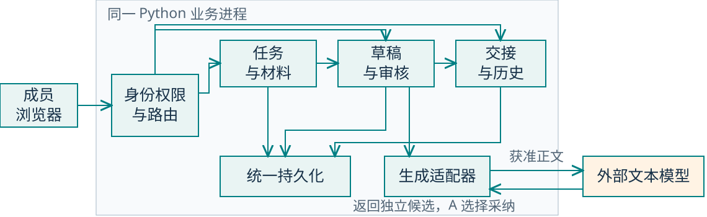
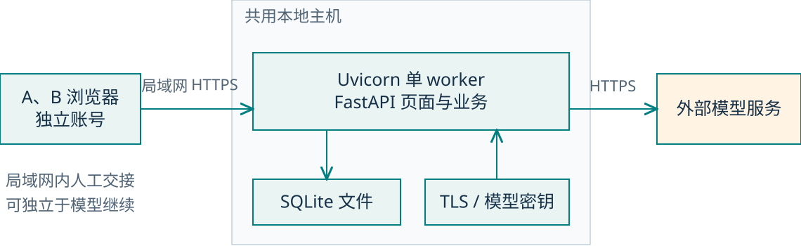
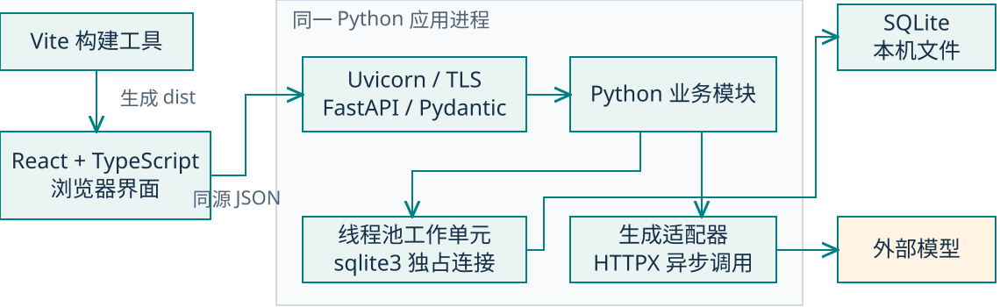
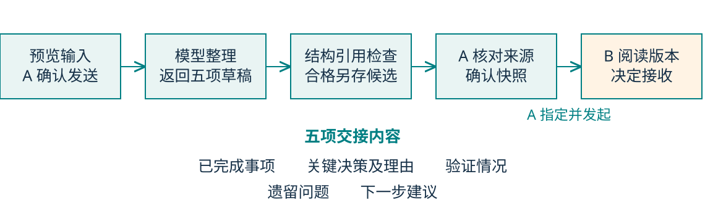
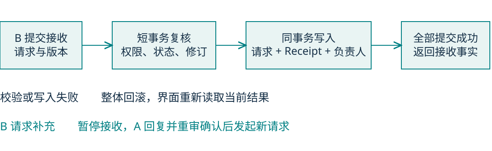
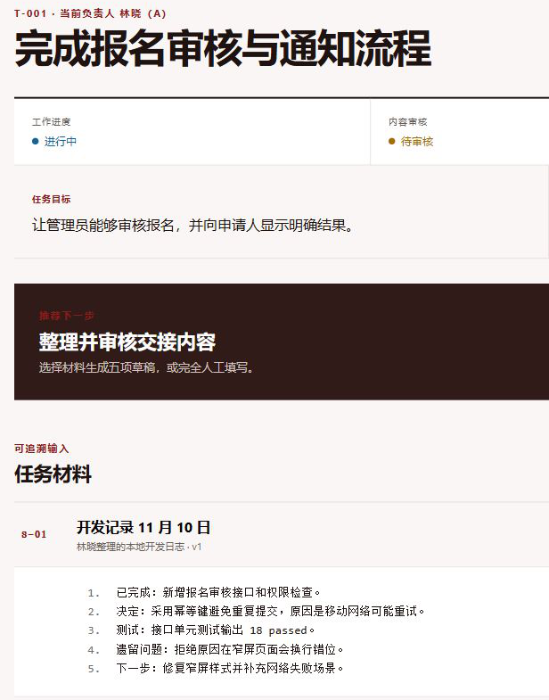
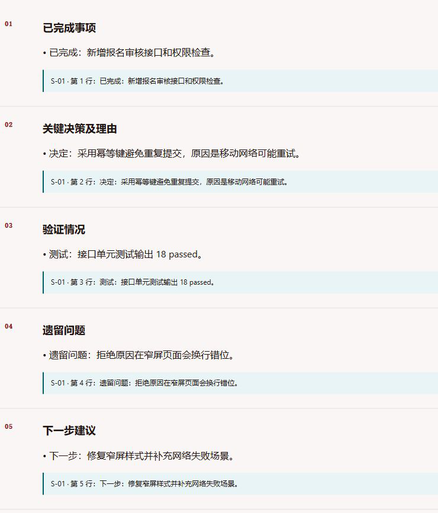
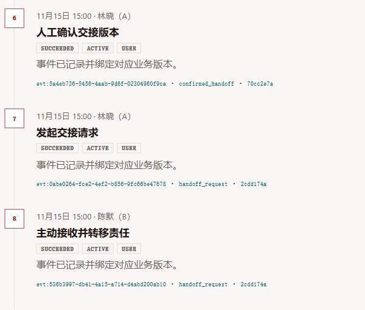

# 团队 AI 工作交接助手

## 系统架构设计

Assignment 2 · 第 16 组

彭奕尊、刘梓涵、郑书宏、仇智

让接手者看清工作依据，并明确承担任务责任

<!-- layout: cover -->
<!-- time: 6 -->
<!-- source: SDD §1、§8；团队成员据 assignment1/docs/proposal/Stage1_Review_Report.md §1。全文以系统设计为汇报对象，原型实验成果集中于第10页。 -->

---

# 核心场景与交接困难

## A 暂停开发，B 需要接着完成同一任务

- 工作笔记和 AI 记录分散，B 难以定位当前依据
- “已经通过”的描述缺少检查输出，可靠性需要核对
- 材料持续变化，双方需要明确交接版本和接收时点

<!-- layout: text -->
<!-- time: 8 -->
<!-- source: SRS §1–2、BG-01–04；SDD §1。 -->

---

# 关键需求与设计目标

## 设计围绕可核对的内容和明确的责任

- 材料分散易遗漏，用五项结构整理并逐项定位来源
- 结论需要证据，A 对照原文核对、修改并确认固定版本
- 责任转移需要明确同意，指定 B 主动接收后才变更负责人
- 模型失败时，人工填写仍能完成交接

首版面向 2–4 人的开发任务交接

<!-- layout: text -->
<!-- time: 10 -->
<!-- source: SRS D-01–D-03、FR-007–021、FR-022–024；SDD §1、AD-04–06。五项为已完成事项、关键决策及理由、验证情况、遗留问题、下一步建议。重要变更触发重审，具体机制见责任转移页。 -->

---

# 总体架构与选型理由

## 模块化单体支撑首版人工交接闭环

- 接收与责任转移须一致，单业务进程与 SQLite 集中维护事务
- 2–4 人采用进程内模块，减少微服务部署与跨服务一致性成本
- 人工导入沿用现有开发工具，集中做好来源核对与责任交接

逻辑视图说明职责，部署视图说明运行位置，技术视图说明实现映射

<!-- layout: text -->
<!-- time: 25 -->
<!-- source: SDD AD-01–03、AD-06–07、§5.1；SRS §2.3–2.4、NFR-006、011。技术栈按SDD0.5定稿。人工导入支持工具无关的材料获取，使MVP先聚焦交接业务。 -->

---

# Logical Architecture 逻辑架构

## 业务模块围绕来源、确认快照与接收协作

- 材料与审核分工，便于逐项回看来源并固定交接版本
- 交接统一处理请求与接收，让责任变更绑定同一确认版本

<!-- layout: diagram -->
<!-- time: 40 -->
<!-- source: SDD §3、§5.1、图源/logical.mmd。职责划分对应材料来源、内容审核和责任交接三项业务关注，权限入口统一识别操作者。审核输出固定版本供交接模块读取，来源与责任均可回看。演示图合并路由和权限入口，全部业务模块及生成适配器位于同一Python进程。 -->

---

# Deployment Architecture 部署架构

## 多个成员浏览器访问同一台本地主机

- 共用主机保存同一份请求，让 A、B 依据一致的数据接收
- 页面与 API 共用 HTTPS 入口，简化成员访问和团队部署

<!-- layout: diagram -->
<!-- time: 35 -->
<!-- source: SDD §4、AD-03、图源/deployment.mmd。共用主机承载Uvicorn/FastAPI与SQLite，使成员操作同一份请求与版本。页面和API同源交付，简化多设备访问配置。图中单worker与TLS配置为部署设计参数。 -->

---

# Technology Architecture 技术架构

## 业务输入统一校验，模型接入独立适配

- FastAPI 统一校验业务输入，sqlite3 用显式事务保存交接事实
- 模型接入集中在生成适配器，便于更换供应商并复用审核流程

<!-- layout: diagram -->
<!-- time: 30 -->
<!-- source: SDD §1、AD-02–03、AD-06、§5–5.2、§9.6、图源/technology.mmd。FastAPI校验请求结构，业务层执行权限及状态规则；原生sqlite3的显式事务保存接收事实与负责人变更。生成适配器通过HTTPX调用外部模型API，将供应商响应差异封装在适配器内。前端构建产物由FastAPI同源提供。 -->

---

# AI 草稿与人工审核

## A 对照来源确认，B 阅读同一份固定版本

- 五项内容与来源片段并排，A 核对后一次确认交接版本
- AI 候选与人工填写共用编辑入口，B 按版本阅读并补充沟通

<!-- layout: diagram -->
<!-- time: 35 -->
<!-- source: SDD §6.2–6.3；SRS FR-008–012、021、D-05。A预览并确认模型输入，程序检查结构与引用定位，A对照来源核对语义并确认版本，再指定B发起交接。五项覆盖完成事项、决策理由、验证情况、遗留问题和下一步。 -->

---

# 责任转移的一致性

## 接收事实与负责人变更一起提交

- 接收绑定 B 阅读的固定版本，记录接收人、时间与交接依据
- 正文或引用材料变更使旧请求失效，A 重审后再发起

<!-- layout: diagram -->
<!-- time: 45 -->
<!-- source: SDD §5.2、§6.3–6.4、图源/acceptance.mmd；SRS D-01–03、AT-04–07。单个事务提交请求状态、唯一Receipt与负责人变更。B请求补充后由A重审并发起新请求，工作进度由负责人独立维护。 -->

---

# Harness 原型的可行性验证

## CSV Policy 中，历史上下文帮助保留仓库外的约束

我们使用了自建的harness快速原型做了验证实验

- Harness 原型跑通自动记录、上下文整理、交接生成及新 Agent 接手
- C0 仅任务说明与仓库，隐藏测试 6/8，遗漏“跳过全空行”
- C1 完整记录与 C2 交接材料均通过 8/8，保留该产品约束
- 结果支持在交接中保留产品约束与决策理由，由 A 对照来源确认

两项小任务采用单模型、各条件单次对照，CSV Policy 交接材料为确定性生成

<!-- layout: text -->
<!-- time: 25 -->
<!-- source: SDD §6.2、§7.1。handoff-verify固定提交99403a53dada1224709c8853c9944b6778298ac1。pagination任务跑通原型链路，三条件均通过隐藏测试，LLM提取后经确定性过滤。CSV Policy任务C0=6/8、C1=C2=8/8，C0遗漏开发记录中的空行策略，C2材料由明确决策条目确定性生成。将原型发现用于强化既有产品约束、决策理由和人工来源核对设计，属于设计依据推论。端到端LLM提取稳定性及正式产品的人类交接验收按SDD§7后续开展。报告 https://github.com/Mavscholangki/handoff-verify/blob/99403a53dada1224709c8853c9944b6778298ac1/docs/report.md 与 https://github.com/Mavscholangki/handoff-verify/blob/99403a53dada1224709c8853c9944b6778298ac1/docs/report-csv-policy.md 。 -->

---

<!-- _class: demo -->

# Web Demo 交接流程展示

## 同一任务串起来源材料、交接版本与主动接收

| 任务背景与来源材料 | 五项交接内容与来源定位 | 人工确认与主动接收 |
| :---: | :---: | :---: |
|  |  |  |
| S-01 v1 材料 | 决策理由 ↔ S-01 第2行 | A 确认 → B 主动接收 |

<!-- layout: demo -->
<!-- time: 35 -->
<!-- source: demo截图/选图说明.md。三张截图来自2026-11-15、本地Web Demo仓库33fe349的同一任务。01为A导入/查看S-01 v1材料，02为B阅读五项交接内容及对应来源行号，03记录A确认、A发起与B主动接收。Demo采用本地确定性DemoGenerator，所示18 passed为预置材料内容。Demo数据访问采用SQLAlchemy，与SDD原生sqlite3方案存在实现差异。该页展示交互业务闭环，Harness的CSV Policy对照另见第10页。 -->

---

# 质量属性与设计取舍

## 质量属性落实到交接机制

- 可追溯性采用版本快照保留依据，代价是保存多份文本
- 可用性复用人工审核与后备路径，A 承担最终核实工作
- 共用本地主机简化部署，服务维护与备份由团队负责

性能目标为 4 人 / 100 任务 / 每任务 ≤ 20 材料，普通操作 p95 ≤ 2 秒

<!-- layout: text -->
<!-- time: 15 -->
<!-- source: SDD AD-01、03–06、§7；SRS NFR-005–010、§7.1。目标负载为4名并发成员、100个任务、每任务至多20份材料，普通操作p95≤2秒。数值为SRS设计验收目标。人工路径复用编辑、确认与接收入口。 -->

---

# 需求变化、Open Issues 与后续规划

## MVP 聚焦人工交接，自动化沿同一流程演进

- 需求变化　业务需求沿用 SRS 1.6，Go 转 Python 属于技术决策更新
- Open Issues　模型供应商、依赖版本、局域网与证书配置需落实
- 后续规划　先完成人工交接闭环，再接入事件采集与持续上下文管理

两个阶段复用人工审核、版本确认与责任交接流程

<!-- layout: text -->
<!-- time: 21 -->
<!-- source: SDD §1.1、AD-07、§3.3、§7–8、§9.6；SRS AT-01–10、D-01–05。需求变化依据SDD§8.1，MVP业务需求沿用SRS1.6，Go转Python为技术决策更新。当前Open Issues摘取SDD§8.2的OI-01运行与依赖版本、OI-02局域网与证书配置及OI-04模型供应商。后续规划依据SDD§8.3，事件采集与持续管理具体需求及输入授权需演进评审。AT-10以共享模板对照双方总用时、遗漏及澄清次数。13页计划讲述合计330秒（5分30秒），三种架构及审核/接收共185秒，Web Demo 35秒，全体组员到场，具体分工与口头节奏由小组试讲确定。 -->
